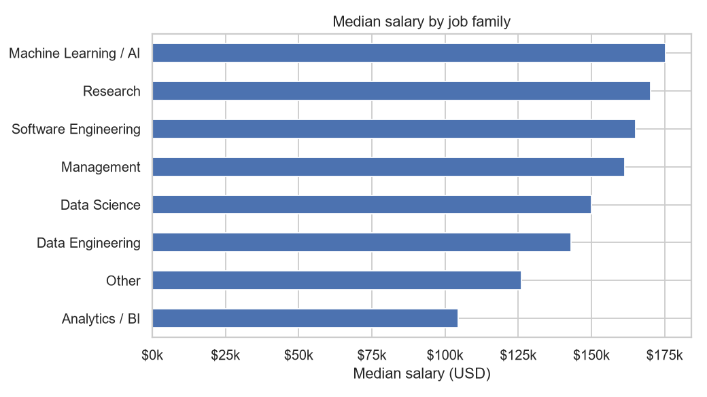
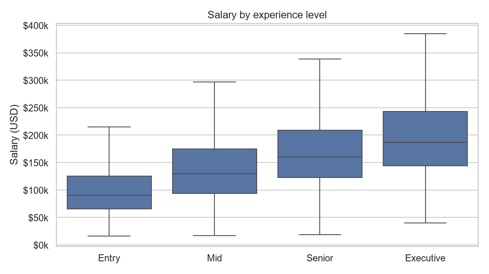
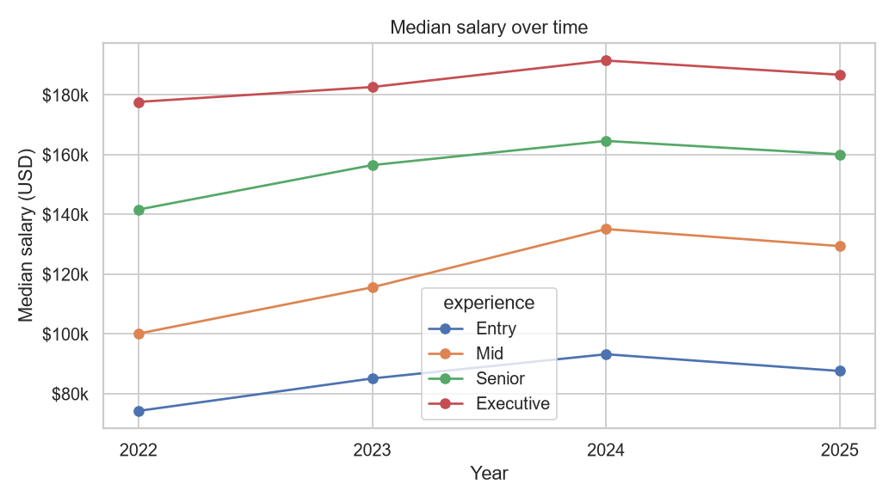
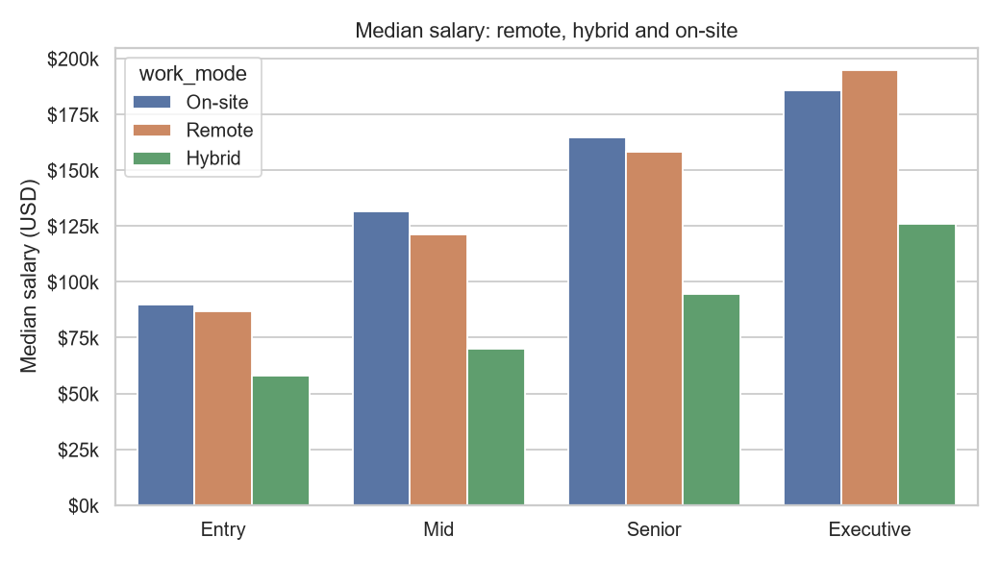
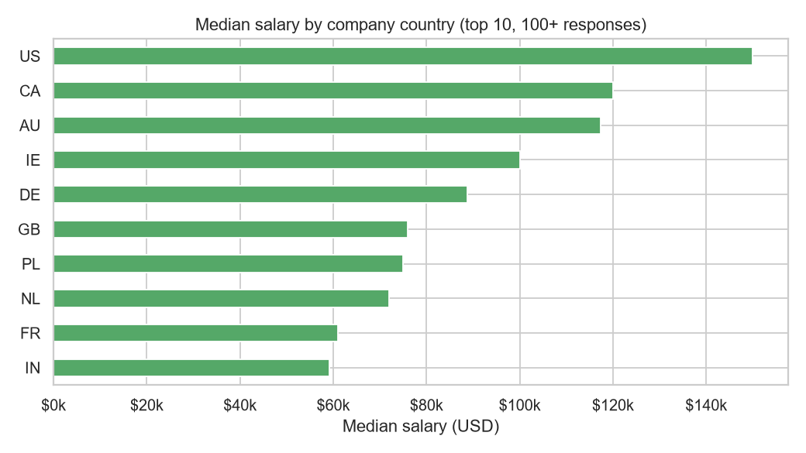

# What do AI, ML and data jobs pay?

An analysis of **151,000+ salaries** from the [aijobs.net salary survey](https://aijobs.net/salaries/) (2020 to 2025), plus a small model and command-line tool that estimates a salary for a given role, level and country.



## Key findings

| | |
|---|---|
| **Experience matters most** | Median pay roughly doubles from Entry ($90k) to Executive ($187k). |
| **ML / AI roles pay the most** | ML and AI roles have a median of $175k, against $105k for analytics and BI roles. |
| **Remote pays about the same as on-site** | Median $145k remote vs $147k on-site. Hybrid responses are lower ($77k), mostly because they come from smaller markets. |
| **Location is the second biggest factor** | US companies pay far more than the rest of the sample. 89% of responses come from US companies, so treat other countries with care. |

Full numbers: [reports/results.md](reports/results.md).

<p>
  
  
  
  
</p>

## Estimate a salary

```bash
pip install -e .
ds-salary --experience Senior --family "Data Science" --country GB --mode Remote
```

```
Estimated salary: $97,950 per year
(typical error about $43,362; 3,901 survey responses from companies in GB)
```

Options: `--experience` (Entry, Mid, Senior, Executive), `--family`, `--country` (ISO code), `--size` (Small, Medium, Large), `--mode` (On-site, Hybrid, Remote), `--employment`, `--year`, `--abroad`.

## How it works

1. **Cleaning** ([`data.py`](src/ds_salary/data.py)): decodes the survey codes, groups 400+ job titles into 8 job families, and drops the top and bottom 1% of salaries each year to remove obvious entry errors.
2. **Figures** ([`plots.py`](src/ds_salary/plots.py)): the five charts above.
3. **Model** ([`model.py`](src/ds_salary/model.py)): gradient boosting (`HistGradientBoostingRegressor`) on log salary, using experience, job family, country, company size, work mode, employment type and year. It is compared with a simple baseline: the median salary for the same experience level and job family.

| | Mean absolute error |
|---|---|
| Baseline (median by experience and family) | $45,760 |
| Gradient boosting | $43,362 |

The model only beats the baseline by a small margin. Most of the spread in pay comes from things the survey does not record, such as the company, the city and the person's skills. Use the estimate as a rough range, not a number to negotiate on.

## Run it yourself

```bash
pip install -e ".[dev]"
python run_analysis.py   # rebuilds figures/ and reports/results.md
pytest                   # tests
```

## Data

`data/salaries.csv` is a snapshot of [foorilla/ai-jobs-net-salaries](https://github.com/foorilla/ai-jobs-net-salaries), published under CC0 (public domain). Salaries are self-reported and anonymous, and most come from the US, so results for other countries are less reliable.

## License

Code: MIT. Data: CC0.
